[](https://pypi.org/project/inventree-kicad-plugin/)
[](https://github.com/afkiwers/inventree-kicad-plugin/actions/workflows/style.yaml)

# InvenTree KiCad - HTTP Library Plugin

A KiCad Conform API endpoint plugin, designed for integration with [InvenTree](https://inventree.org), empowers users to seamlessly incorporate InvenTree parts into KiCad's parts library tool. Please note that this plugin exclusively offers metadata and necessitates the presence of corresponding symbol and footprint libraries within the KiCad EDA environment.

As of the current stage of development, KiCad exclusively offers read-only access to parts through the HTTP lib interface.

## Compatibility Matrix

> [!IMPORTANT]
> Due to major version differences in the InvenTree software, not all plugin versions are intercompatible.

The following table shows the compatibility between the **InvenTree KiCad Plugin** and **InvenTree** versions.

| InvenTree Version | Plugin Version | Notes |
|-------------------|--------------------------------|-------|
| `< 1.2.0`         | `< 2.0.0`                      | Older InvenTree releases require plugin versions prior to `2.0.0` |
| `>= 1.2.0`        | `>= 2.0.0`                     | InvenTree `1.2.0` and newer require plugin version `2.0.0` or later |

### Notes

- InvenTree versions **1.2.0 and newer** introduced API changes requiring `inventree_kicad` **v2.0.0+**
- If using an older InvenTree installation, ensure the plugin version remains below `2.0.0`
- Always verify compatibility before upgrading either InvenTree or the KiCad plugin


## Installing the Plugin

There are several methods available for installing this plugin. To gain a comprehensive understanding of the installation process, please refer to the [InvenTree - Installing a Plugin Guide](https://docs.inventree.org/en/latest/plugins/install/#installation-methods). Depending on your preferred approach, the following instructions will provide you with the necessary information.

Prior to plugin installation, ensure that you've activated both **URL Integration** and **App Integration**. You can accomplish this by going to Settings → Plugin Settings → Plugins. Additionally, if you're operating within a Docker environment, be sure to enable **Check plugins on startup** as well.

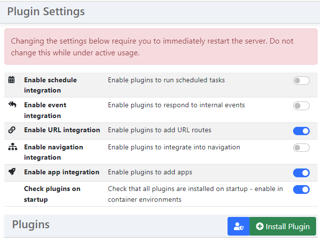

### Through GitHub

Navigate to the **Plugin Settings** and click on the Install Plugin button. This will trigger a new window to appear, prompting you to enter the following information:

- Package Name: inventree-kicad-plugin
- Source URL: <git+https://github.com/afkiwers/inventree_kicad>

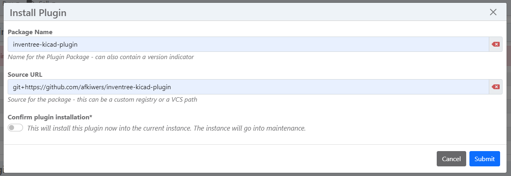

### Through PiP

The plugin can be found here: [inventree-kicad-plugin](https://pypi.org/project/inventree-kicad-plugin/).

- Package Name: inventree-kicad-plugin

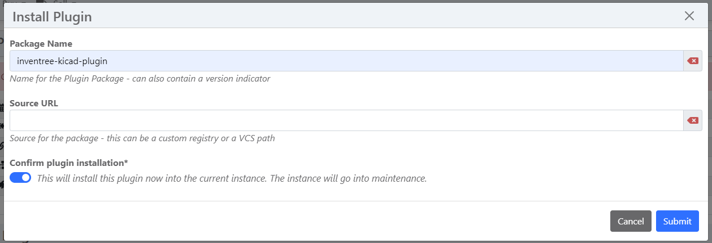

**IMPORTANT**: Remember to restart your server and run the migrate command to implement the model changes required for this plugin. Failure to do so may result in the plugin encountering issues and not functioning correctly.

## Configure Plugin Settings

After installing the plugin, head over to the Plugin Settings and activate it. Look for **KiCadLibraryPlugin** in the list of available plugins. 

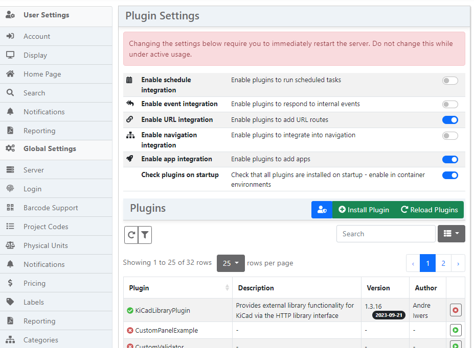


Once activated, you'll see a new plugin **KiCad Library Endpoint** on the left hand side. Click on it to open the plugin and proceed with the setup process.

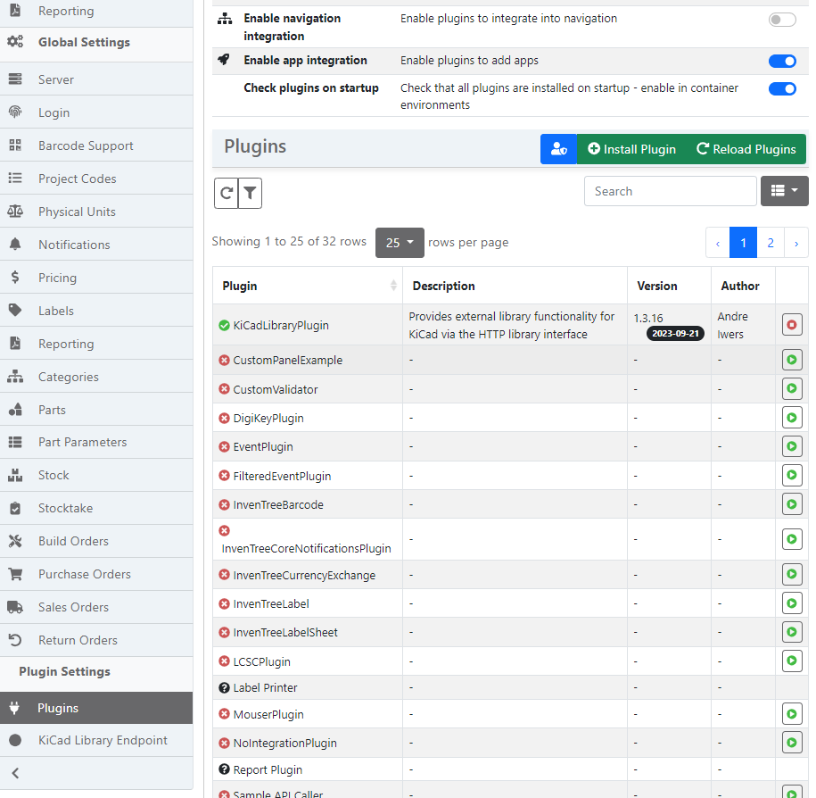


## Adding Categories to KiCad

Navigate to the admin backend (URL: https://inventree.server.url/admin/inventree_kicad/), and scroll down until you find the **INVENTREE_KICAD** section. Within this section, click on **KiCad Categories**.
If the section is not visible, ensure you've enabled the "Enable URL integration" and "Enable app integration" options in the Plugin Settings and run a database migration. If you still can't see those inventree_kicad tables, check your user; you might lack permissions to access those.

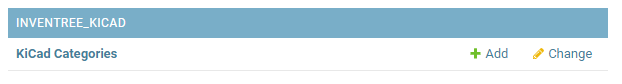

Once opened the "KiCad Categories" model, you'll have the option to add new categories which, once added, will be visible in KiCad's Symbol Chooser dialog.

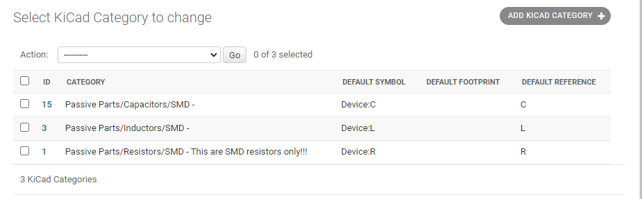

### Adding Categories to KiCad via REST API
Alternatively you can use the REST API to add categories to KiCad. 
The API can be accessed via the endpoint `/plugin/kicad-library-plugin/api/category/`

#### Retrieve Active Categories

##### To get a list of all active categories
**`GET`** `/plugin/kicad-library-plugin/api/category/`

Returns
```
[
  {
    "pk": 2,
    "category": {
      "id": 12,
      "name": "Tantalum",
      "pathstring": "Capacitors/Tantalum",
      ...
    },
    "default_symbol": "Device:C_Polarized",
    "default_footprint": "",
    "default_reference": "C",
    "default_value_parameter_template": {
      "id": 49,
      "name": "Value",
      ...
    },
    "footprint_parameter_template": {
      "id": 8,
      "name": "Footprint",
      ...
    }
  },
  {
    "pk": 1,
    "category": {
      "id": 6,
      "name": "Ceramic",
      "pathstring": "Capacitors/Ceramic",
      ...
    },
    "default_symbol": "Device:C",
    "default_footprint": "",
    "default_reference": "C",
    "default_value_parameter_template": {
      "id": 49,
      "name": "Value",
      ...
    },
    "footprint_parameter_template": {
      "id": 8,
      "name": "Footprint",
      ...
    }
  },
  ...
]
```

##### Get a Specific Category

**`GET`** `/plugin/kicad-library-plugin/api/category/<id>/`

where `<id>` is the primary key of the KiCad category, not the InvenTree category.

Returns (for `/plugin/kicad-library-plugin/api/category/1/`)
```
{
    "pk": 1,
    "category": {
      "id": 6,
      "name": "Ceramic",
      "pathstring": "Capacitors/Ceramic",
      ...
    },
    "default_symbol": "Device:C_Polarized",
    "default_footprint": "",
    "default_reference": "C",
    "default_value_parameter_template": {
      "id": 49,
      "name": "Value",
      ...
    },
    "footprint_parameter_template": {
      "id": 8,
      "name": "Footprint",
      ...
    }
}
```

#### Add a New Category
To add a category to KiCad call

**`POST`** `/plugin/kicad-library-plugin/api/category/`

JSON data:
```
{
    "category": <INVENTREE_CATEGORY_PK>,       // mandatory
    "default_symbol": "",                      // optional
    "default_footprint": "",                   // optional
    "default_reference": "",                   // optional
    "default_value_parameter_template": null,  // optional
    "footprint_parameter_template": null       // optional
}
```

*Note:* The parameter templates can be set either via `id`, or `name`. Set the value to a `number` or `string` respectively.

#### Update Category
To update an existing category call

**`PATCH`** `/plugin/kicad-library-plugin/api/category/<id>/`

The request data only has to contain the values you want to change, e. g.: 
```
{
    "default_symbol": "Device:C",
    "default_value_parameter_template": "Value",
    "footprint_parameter_template": 2
}
```

*Note:* The parameter templates can be set either via `id`, or `name`. Set the value to a `number` or `string` respectively.

#### Delete Category
To remove a category from KiCad call

**`DELETE`** `/plugin/kicad-library-plugin/api/category/<id>/`

without any data, where `<id>` is the KiCad category id. 

*Note:* There is no undo! Be sure before calling.

### Default Settings for Categories

The plugin allows you to set default values when the child part lacks specific details regarding the KiCad symbol, footprint, or reference. This feature is particularly useful when dealing with components such as resistors or capacitors, as they often share the same symbols, reducing the need for repetitive data entry.

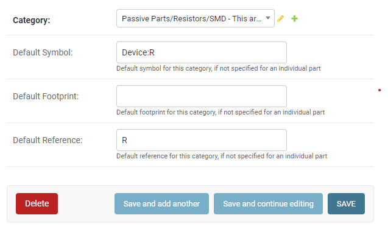

### Utilizing Footprint Parameter Mapping

If you have existing Footprint/Package Type parameters assigned to your components and prefer not to define a separate KiCad Footprint Parameter for them, you can leverage the Footprint Parameter Mapping functionality to establish a connection to KiCad Footprint names. Simply incorporate the desired mappings into the KiCad category:

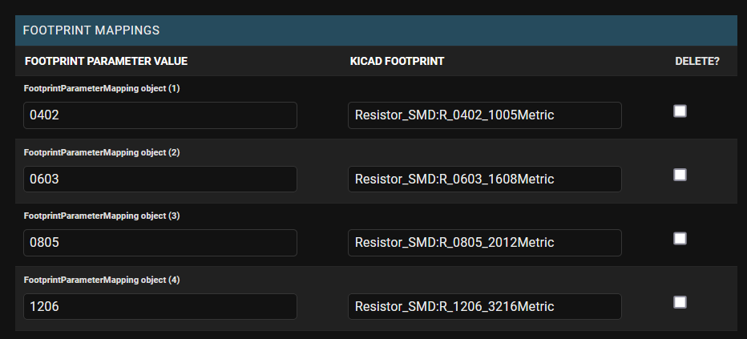

Additionally, you can combine this with the per-category "Footprint Parameter Template" override to utilize a different parameter for mapping purposes.


### Setting Default Visibility of Footprint Parameters

If you want to make specific parameters always visible on a footprint, you can add a new parameter to your part parameter template to configure the default visibility.

By default, setting a parameter named `Kicad_Visible_Fields` with comma-separated names of the parameters you would like to be visible on your footprint will be set as visible. Spaces between commas and parameter names are tolerated.

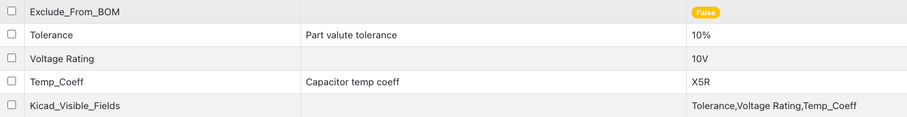

The parameter name used to check field visibility can be changed in settings. This parameter will not be visible from KiCad.

### KiCad Field Mapping

By default, the fields sent to KiCad use the InvenTree names: `IPN`, `Part URL`, the part parameter names (e.g. `Tolerance`), and, with manufacturer data enabled, `Manufacturer_1`, `MPN_1`, `Supplier_1_1`, `SPN_1_1`, and so on. If your libraries or BOM tools expect different names or other values, use the **KiCad Field Mapping** table in the **Plugin Configuration** panel on the plugin's settings page. Nothing changes until you add a row.

Each row has a source on the left and a KiCad field name on the right. The source is either:

- **a field name**, e.g. `IPN`: the field is **renamed** to the KiCad field name, or
- **a template**, e.g. `{part.IPN}`: the KiCad field is **filled** with the template's value. Templates can use any [part value or parameter](#formatting), e.g. `{part.keywords}` or `{param[Tolerance]}`, mixed with text, e.g. `{part.name} rev {part.revision}`.

Start typing in the left column to pick from the known field names, or type `{` to pick a part value or parameter. Below each row, the panel shows what it does, and for templates an example value. Changes are saved automatically.


#### Example: Renaming Fields

Say your company calls the internal part number `SKU`, links to InvenTree with a `Link` field, uses a short `Tol` field, and has a single manufacturer per part. You'd enter:

| Source | KiCad field |
| ------ | ----------- |
| `IPN` | `SKU` |
| `Part URL` | `Link` |
| `Tolerance` | `Tol` |
| `Manufacturer_1` | `Manufacturer` |
| `MPN_1` | `MPN` |

With **Include IPN** and **Add Manufacturer Data to KiCad Parts** enabled, the `fields` of a part (`/plugin/kicad-library-plugin/v1/parts/<id>.json`) change like this. Values and visibility stay the same; only the names change.

Before:

```json
"fields": {
    "value": {"value": "10k"},
    "reference": {"value": "R", "visible": "True"},
    "InvenTree": {"value": "42", "visible": "False"},
    "Part URL": {"value": "https://inventree.example.com/web/part/42/", "visible": "False"},
    "IPN": {"value": "R-0001", "visible": "True"},
    "Tolerance": {"value": "1%", "visible": "False"},
    "Manufacturer_1": {"value": "Yageo", "visible": "False"},
    "MPN_1": {"value": "RC0603FR-0710KL", "visible": "False"}
}
```

After:

```json
"fields": {
    "value": {"value": "10k"},
    "reference": {"value": "R", "visible": "True"},
    "InvenTree": {"value": "42", "visible": "False"},
    "Link": {"value": "https://inventree.example.com/web/part/42/", "visible": "False"},
    "SKU": {"value": "R-0001", "visible": "True"},
    "Tol": {"value": "1%", "visible": "False"},
    "Manufacturer": {"value": "Yageo", "visible": "False"},
    "MPN": {"value": "RC0603FR-0710KL", "visible": "False"}
}
```

#### Example: Filling Fields from Templates

Templates add fields the plugin doesn't send by default, and can set the KiCad fields `value`, `description`, `keywords` and `datasheet`. No other setting is needed, e.g. `SKU` works without **Include IPN**:

| Source | KiCad field | Result for the part above |
| ------ | ----------- | ------------------------- |
| `{part.IPN}` | `SKU` | `R-0001` |
| `{param[Manufacturer Code]}` | `MPN` | the part's `Manufacturer Code` parameter |
| `{part.category}` | `Category` | `Electronics/Passives/Resistors` |
| `{part.keywords}` | `keywords` | the part's keywords (replaces KiCad's keywords) |
| `{part.name} rev {part.revision}` | `description` | `RES-10K-0603 rev A` (replaces KiCad's description) |

New fields are hidden in the schematic (`"visible": "False"`); when a template replaces an existing field, that field keeps its visibility. A parameter the part doesn't have is empty, so the field is still sent.

**Migrating from a database library:** if your existing schematics use a field such as `Part Number` for the internal part number, map `{part.IPN}` → `Part Number` (or rename `IPN` → `Part Number` with **Include IPN** enabled). To keep the link of placed symbols to the library as well, see [Part Name / Symbol Link](#part-name--symbol-link).

#### Rules

- Field names are matched case-insensitively (`ipn` matches `IPN`).
- Renaming: the KiCad fields `value`, `footprint`, `datasheet`, `reference`, `description`, `keywords` and the `InvenTree` part ID field can't be renamed, and can't be used as a new name. Renaming a field to a name another field already has is skipped, so no data is overwritten.
- Templates can fill any field except `footprint`, `reference` (use the **Footprint Parameter** / **Reference Parameter** settings) and `InvenTree`. A template replaces a field of the same name.
- Each source can only be renamed once, and each KiCad field name can only be used once.
- `{part.stock}` needs **Display Available Stock**, and `{part.used_in}` is slow (see [Formatting](#formatting)).
- Field visibility (`Kicad_Visible_Fields` and its global setting) keeps using the original parameter names.
- Symbols already placed in a schematic keep their old fields until they are updated from the library.

### Part Name / Symbol Link

KiCad links a placed symbol to the library through the part name sent by the plugin (`<library nickname>:<part name>`). By default this is the part name, or the IPN with **Use IPN Instead of Name** enabled.

The **Part Name Template** setting lets you use any other value, with the same template values as above. This is useful when migrating from a KiCad database library, whose symbols are linked by a key column:

| Part Name Template | Part name in KiCad |
| ------------------ | ------------------ |
| *(empty, default)* | the part name, or the IPN (see above) |
| `{part.IPN}` | `R-0001` |
| `{param[Legacy ID]}` | the part's `Legacy ID` parameter, e.g. the key of your old database library |
| `{part.IPN}_{part.revision}` | `R-0001_A` |

Typing `{` in the setting lists the available values. If the template is empty for a part (e.g. the parameter is missing), that part falls back to the default name.

**Please Note:**
- Changing the part name breaks the library link of symbols already placed in schematics, unless the new names match the old links.
- Part names should be unique, as KiCad looks parts up by name.

## Creating User Access Tokens

Return to the administrative backend, navigate to the USER model, and access API Tokens. Select "ADD API Token" to generate a token designated for a specific user. It's crucial to highlight the importance of creating separate tokens for each user, rather than using a universal token for everyone.

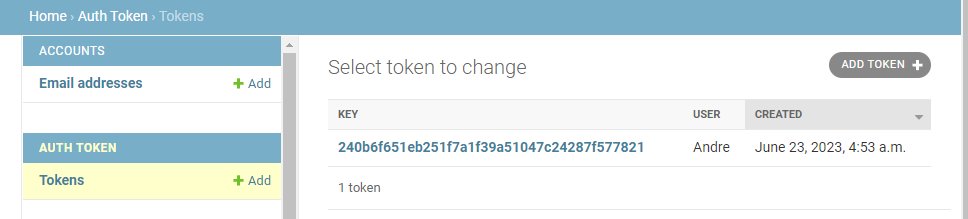

## KiCad HTTP Library File

Below is an example config which should help you get started reasonably quickly. The only thing needed here is to replace **<http://127.0.0.1:8000>** with your server's InvenTree URL, and replace usertokendatastring with a valid token. Save it as a file with `.kicad_httplib` extension, as specified in the [preliminary KiCad docs](https://docs.kicad.org/master/en/eeschema/eeschema_advanced.html#http-libraries). To use it, add it as a symbol library inside KiCad.

**Please Note**: The config file does not contain any part or category information. It merely tells KiCad what API to expect, what token to use and where to find it.

```json
{
    "meta": {
        "version": 1.0
    },
    "name": "KiCad HTTP Library",
    "description": "A KiCad library sourced from a REST API",
    "source": {
        "type": "REST_API",
        "api_version": "v1",
        "root_url": "http://127.0.0.1:8000/plugin/kicad-library-plugin",
        "token": "usertokendatastring",
        "timeout_parts_seconds": 60,
        "timeout_categories_seconds": 6000
    }
}
```

## Add the HTTP library to KiCad

Inside KiCad's project manager, navigate to `Preferences -> Manage Symbol Libraries` and click on it. Add a GLobal Library by pressing the folder in the bottom left corner.
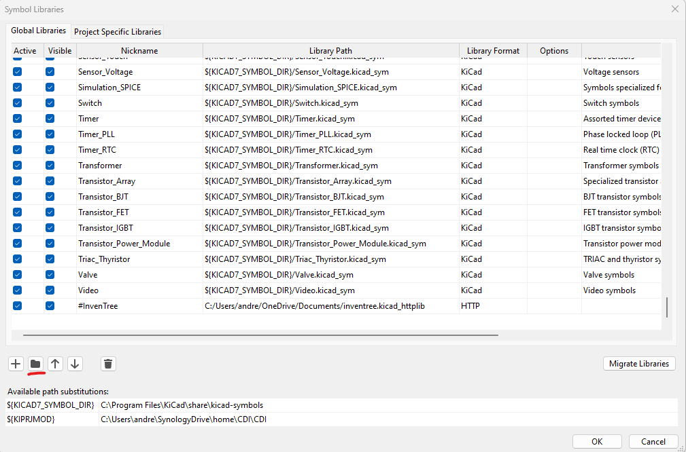

When choosing the `.kicad_httplib` file, KiCad will automatically detect that it is a HTTP lib file and only a Nickname needs to be set.

It's recommended to put a **#** as prefix to make sure it is at the top of the list. Otherwise one might end up scrolling a lot.

## Display Stock Information in KiCad
If activated KiCad will show stock data inside the symbol chooser. The data will be updated whenever the set category timeout expires ([`timeout_categories_seconds`](#kicad-http-library-file)). 

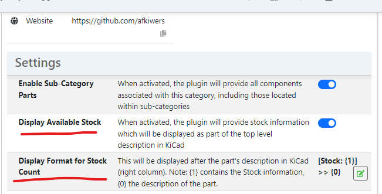

**Please Note:** Due to recent KiCad changes, the stock information is **NOW** transferred into the schematic.

Users have the option to determine the presentation style of stock data through the **Stock Count Display Format** as shown above. In this setting, {0} represents the item description, while {1} represents the stock information as a numerical value. Using those placeholders, users can customize how this data is merged and showcased according to their preferences. An example of how this would look is shown below. 

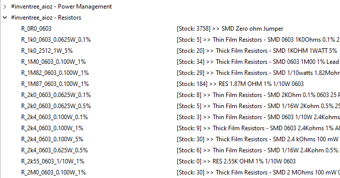

### Formatting

The following part attributes are available, used as `{part.<parameter>}` (e.g. `{part.name}`):

| Parameter     | Type      | Description |
| ------------- | --------- | ----------- |
| `name`        | `str`     | The name of the part. |
| `IPN`         | `str`     | The internal part number. |
| `description` | `str`     | The part’s description (equivalent to `{0}`). |
| `revision`    | `str`     | The part’s revision. |
| `keywords`    | `str`     | The part’s keywords. |
| `units`       | `str`     | The part’s units. |
| `link`        | `str`     | The part’s external link. |
| `category`    | `str`     | The full category path, e.g. `Electronics/Passives/Resistors`. |
| `pk`          | `int`     | The part’s ID in InvenTree. |
| `stock`       | `Decimal` | The unallocated stock count for this part (equivalent to `{1}`). Only available with **Display Available Stock** enabled. |
| `used_in`     | `int`     | The number of assemblies whose BOM uses this part. |

Part parameters are available as `{param[<parameter name>]}`, e.g. `{param[Tolerance]}` (matched case-insensitively; empty if the part doesn't have the parameter).

These values work in the **Stock Count Display Format**, in [KiCad Field Mapping](#kicad-field-mapping) templates and in the [Part Name Template](#part-name--symbol-link).

**Note:** `part.used_in` is only looked up if `{part.used_in}` is part of the format. It uses the same count as InvenTree (including variants, substitutes and inherited BOMs), which requires several additional database queries for every part in a KiCad part list. Large categories can therefore load noticeably slower when it is used. Leave it out of the format if you don't need it; without it, no additional queries are made.

**Note:** `part.stock` is a number, not a string.  
When formatting this value, it’s recommended to include format specifiers to handle decimals gracefully.  

For example: `{part.stock:.0f}`. Here, (`:.0f`) formats the number as a floating point, with no padding, and zero digits trailing the decimal point. For more details, see [Python’s documentation on format strings](https://docs.python.org/3/library/string.html#formatstrings).

### Format Editor

When **Display Available Stock** is enabled, the **Plugin Configuration** panel on the plugin's settings page provides an editor for the **Stock Count Display Format**. Typing `{` lists the available placeholders (insert one with the arrow keys and `Enter`/`Tab`, or by clicking it). A preview using an example part is shown below the input, and the format is saved automatically once it is valid. Typing `{` lists the placeholders in the setting's own edit dialog as well.

### Legacy Format
Still supported: `{0}` and `{1}` which will display as:  {1} Stock information, {0} description of the part.

## Use in KiCad

Once everything has been configured properly, KiCad should be able to display all the categories and parts using the Symbol Picker.

Inside the schematic, one can either use the shortcut and press **A** or navigate to the ribbon at the top and press `Place -> Add Symbol`.

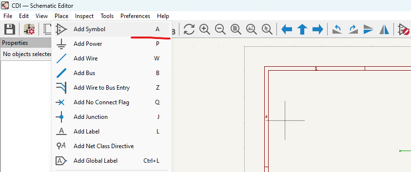

The Symbol Chooser should open up and display the parts sourced from InvenTree.

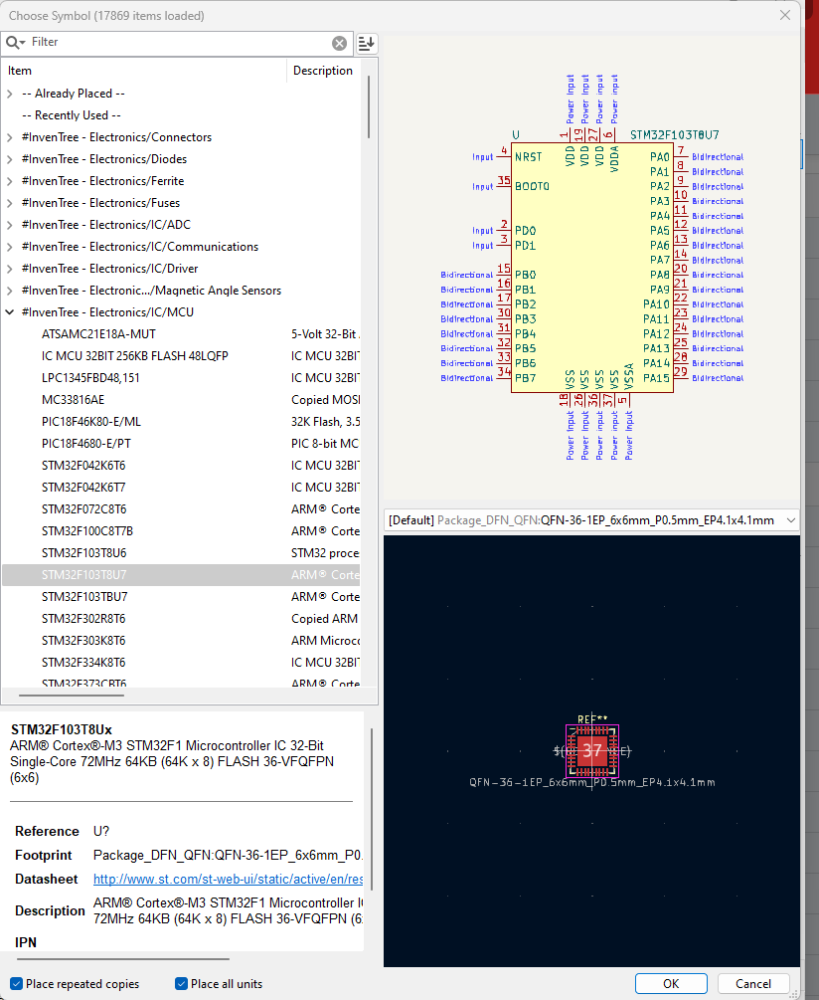

